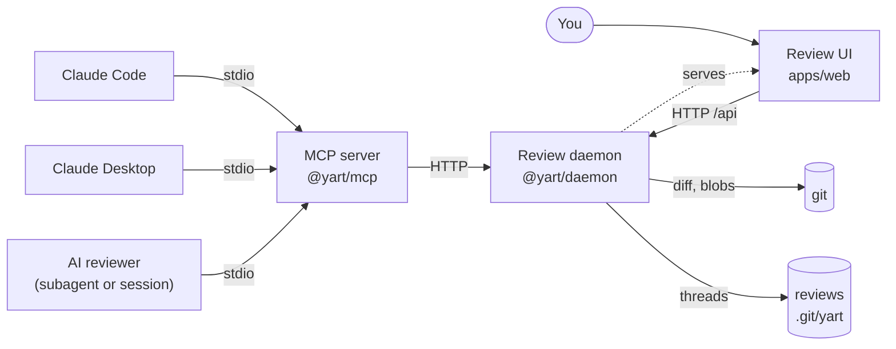
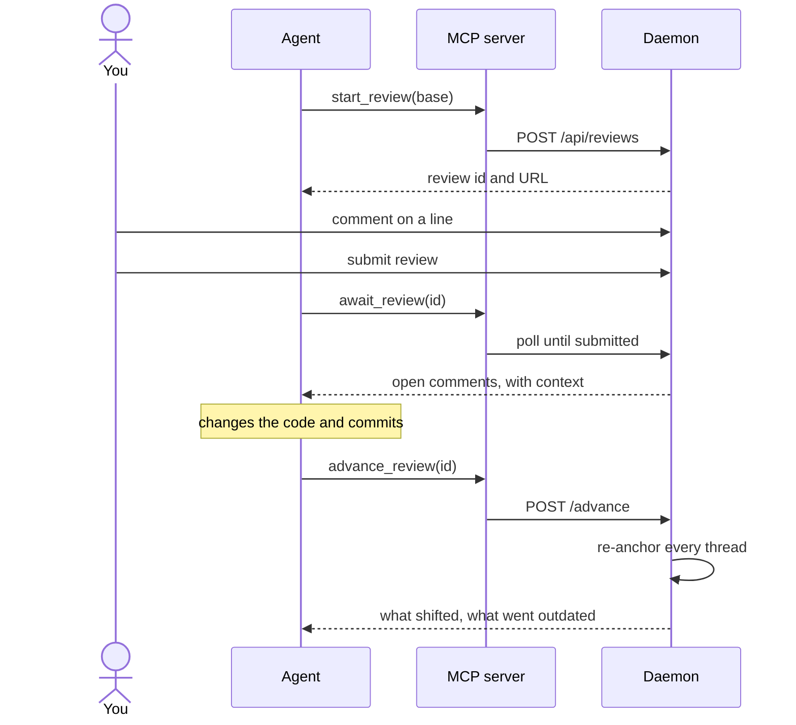
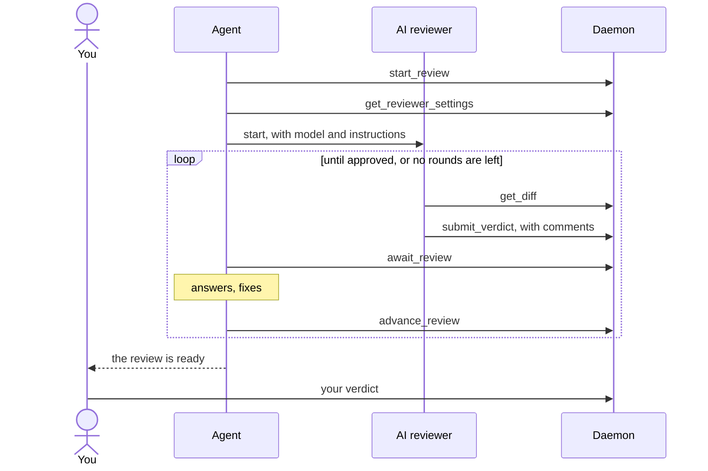
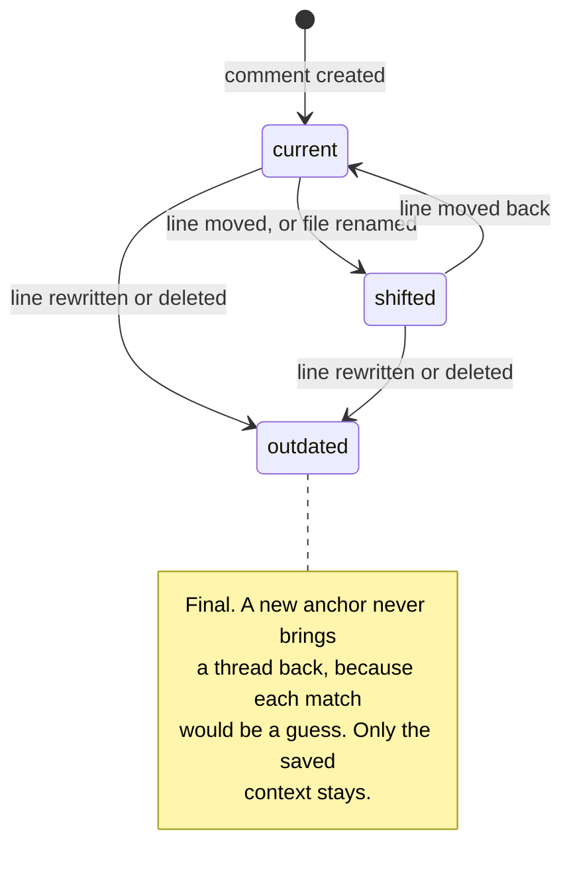

<div align="center">


# yart

**Y**et **A**nother **R**eview **T**ool. Local code review for diffs that AI
agents make, in the style of GitHub. Your comments on lines go back to the agent
over MCP.

[](https://github.com/J3MPA/yart/actions/workflows/ci.yml)
[](https://github.com/J3MPA/yart/releases/latest)
[](https://github.com/J3MPA/yart/releases)
[](#use-yart)
[](LICENSE)

[Quick start](#quick-start) · [Use yart](#use-yart) ·
[Develop yart](#develop-yart) · [How it works](#how-it-works)

</div>

## Quick start

```sh
# Install the app and its two commands. During the beta, see "Install" below.
curl -fsSL https://github.com/J3MPA/yart/releases/latest/download/install.sh | sh

# Let Claude Code use yart.
claude mcp add -s user yart -- ~/.local/bin/yart-mcp
```

Then tell your agent that you want to review its changes. A review opens in the
yart window. Write comments on lines and submit the review. The agent answers,
makes the fixes and asks you to look again. Each comment stays on its line.

## Why

Agents that write code make large diffs quickly. These diffs are difficult to review in
terminal output or in a flat `git diff`. You get no file tree and no easy move
between hunks. You also have no place to say "this line is wrong".

Local diff viewers help you read a diff, but they stop at a **Copy prompt**
button. yart completes the loop. Your comments go back to the agent as
structured data over the Model Context Protocol (MCP). The agent can act on
them, reply to them and resolve them. Nothing goes to GitHub.

|                                | Copy-paste diff viewers | yart                            |
| ------------------------------ | ----------------------- | ------------------------------- |
| Who starts the review          | You, by hand            | The agent, with a tool call     |
| How comments go to the agent   | Text that you paste     | Structured `{file, line, side}` |
| The agent can reply or resolve | No                      | Yes                             |
| State between rounds           | None                    | Threads stay                    |

The last row is the most important. Review is a _loop_: change, review, comment,
fix, and review again. The second review shows only the comments that are still
open. A clipboard keeps no record of the first round.

## Features

- **Reviews that your agent opens and answers.** The agent starts a review with
  a tool call and waits for your verdict. It replies to each comment, resolves
  the comments that it fixed, and moves the review to its new commits.
- **Comments that stay correct when the code changes.** Each comment is attached
  to the content that it is about. Thus it follows its line through edits. yart
  marks it outdated only when that line is gone.
- **AI review before your review.** An AI reviewer can review the work first. The
  two agents go back and forth until the reviewer approves. Then you get the
  review, with all of their comments and answers.
- **A diff that is easy to read.** It has a file tree and syntax highlights. You
  can open hidden context in place, and mark each file as reviewed. You can also
  hold comments until you submit a verdict.
- **A signal when you must look.** A notification and a dock badge when the agent
  answers, and a label that shows how far the agent is.
- **All repositories in one place.** One daemon serves all repositories. Each
  repository keeps its reviews in its own `.git`, thus nothing shows in
  `git status`.
- **A desktop app.** One command installs it, one command updates it and one
  command removes it. It does not need Node or npm.

Planned: export a review to the clipboard, for agents that do not use MCP.

## How it works



The daemon and the MCP server are two different processes. An MCP server starts
and stops with its client. A review must stay after a session stops, and more
than one agent can use it at the same time. Thus the review state is in a
process that no client owns. All agents use the same daemon. The first tool call
starts a daemon if no daemon is on its port.

### The loop

Review is a loop, not one pass. The comment anchors exist because of this loop.



## Use yart

yart runs on macOS. It is an app that has the two commands that an agent and a
terminal need. You do not need Node, npm or `sudo` to install it.

> yart is in beta. Until the first stable release, the command below finds
> nothing to install. Install the newest
> [pre-release](https://github.com/J3MPA/yart/releases) from its own URL, as the
> second example shows.

### Install

```sh
curl -fsSL https://github.com/J3MPA/yart/releases/latest/download/install.sh | sh
```

This command puts `yart.app` in `~/Applications`. It puts links to `yart` and
`yart-mcp` in `~/.local/bin`. If that directory is not on your `PATH`, the
command tells you.

To install a pre-release, such as a beta, use the URL of that release. The
installer of each release installs that release:

```sh
curl -fsSL https://github.com/J3MPA/yart/releases/download/v0.1.0-beta.2/install.sh | sh
```

Use `curl`. Do not download the zip in a browser. A browser marks each download
as quarantined. macOS then does not open the app, and shows "Apple could not
verify yart is free of malware". The reason is that the app has a free ad-hoc
signature, not a paid signature that Apple notarized. `curl` does not mark the
download.

### Connect your agent

```sh
claude mcp add -s user yart -- ~/.local/bin/yart-mcp
```

Use the full path. Claude Code starts MCP servers with its own environment, and
that environment can be without the `PATH` of your shell. For Claude Desktop and
other clients, see [Register it](#register-it).

Then ask for a review. It is sufficient to say that you want to review the code.
An agent does not open a review if you do not ask. It has no reason to decide
that a change is ready for you to see.

### Review a change

A new review opens in the yart window. Do these steps:

1. Write comments on lines. You can hold comments and send them with your
   verdict.
2. Mark each file as reviewed when you finish it.
3. Submit the review.

To show a problem, paste or drop an image into a comment box, or use **Attach
image**. Each image can be 5 MB at most, in PNG, JPEG, WebP or GIF.

The agent reads your comments and answers them. It then moves the review to its
fixes, and each comment follows its line. The window shows the reviews of all
repositories that yart served.

The same reviews are at `http://localhost:7777` in a browser. The app and each
browser keep their own seen state and drafts. When you change from one to the
other, these start again.

### Let an AI review first

An AI reviewer can review the work of an agent before you do. The reviewer and
the agent go back and forth. When the reviewer approves, or when it has no more
rounds, the review is yours.

Before you start, you can set how the reviewer runs. Open **Settings** from the
review list, and go to the **AI reviewer** section:

- **Rounds**: how many verdicts a reviewer can give on one review. The default
  is three.
- **Model**: the model to start the reviewer on, for example `sonnet`. Empty lets
  the agent choose.
- **Effort**: low, medium or high. Only a launcher that accepts an effort uses
  it. Claude Code subagents accept a model, but not an effort.
- **Instructions**: what the reviewer must look for, for example "look at error
  handling and tests".

yart does not run a model. The agent that starts the reviewer reads these
settings with the `get_reviewer_settings` tool.

yart includes a reviewer subagent for Claude Code. yart writes its
instructions, thus the agent whose work is under review does not brief its own
reviewer. The subagent can only read files and use the reviewer tools, thus it
cannot change the code. Add it to a project, or with `--user` to all projects:

```sh
yart reviewer install
```

To start the loop with a subagent, tell the agent that does the work:

> Make the change. Then start a reviewer subagent to review it with yart, before
> you give it to me.

The agent then does these steps:

1. It opens a review with `start_review`.
2. It reads the reviewer settings with `get_reviewer_settings`.
3. It starts the `yart-reviewer` subagent, or a subagent of its own, on the
   model from the settings, with the instructions in its brief.
4. The subagent reads the changes with `get_diff`. It gives a verdict with its
   line comments with `submit_verdict`.
5. The agent reads the verdict with `await_review`. It answers the comments,
   makes the fixes and moves the review with `advance_review`.
6. The agent starts the reviewer again for the next round. This continues until
   the reviewer approves or has no more rounds.
7. The agent tells you that the review is ready for you.

To use a second session as the reviewer, open a new Claude Code session and tell
it:

> Review the open yart review as an AI reviewer. Use get_diff, submit_verdict and
> await_author.

That session waits for the author with `await_author` between rounds. It
continues when the author moves the review or replies to a comment. A reply alone can
mean that the author disagrees, and that also needs an answer.

When the review comes to you, a **Review history** panel at the top shows the
exchange round by round. Each round starts with the verdict of the reviewer and
its summary. Then come its comments and the answers of the agent, each with its
`file:line`. Click a location to go to that file in the diff. The comments of
the reviewer show its name, for example "reviewer claude-reviewer". The answers of the agent show "agent". A
verdict of the reviewer shows "by reviewer". Your verdict is the last verdict.
An approval of the reviewer does not count as yours. It does not start the
clean-up that you set in Settings.

The daemon makes sure of the round limit. It refuses a verdict of a reviewer
that has no more rounds. Then both agents get a message that the review is yours
to complete.



### Review each commit with an AI

A commit hook can make an AI reviewer review the staged changes before each
commit. The commit continues only when the reviewer approves. To set it up, do
these steps:

1. In the repository, run `yart hook install`. This adds a `pre-commit` hook. It
   does not replace a hook that yart did not write.
2. Open **Settings**, and set **Command for the commit hook** in the **AI
   reviewer** section. This is the shell command that starts a reviewer.

The command gets the review in `YART_REVIEW_ID` and `YART_REVIEW_URL`, and the
reviewer settings in `YART_REVIEWER_MODEL`, `YART_REVIEWER_EFFORT` and
`YART_REVIEWER_INSTRUCTIONS`. They are environment variables, not text in the
command. Thus a value with quotes cannot break the command. For Claude Code:

```sh
claude -p "Review the yart review $YART_REVIEW_ID as an AI reviewer. Use get_reviewer_settings, get_diff and submit_verdict. $YART_REVIEWER_INSTRUCTIONS" --model "${YART_REVIEWER_MODEL:-sonnet}"
```

On each commit, the hook does these steps:

1. It makes a tree of the staged changes, and opens a review of it against
   `HEAD`.
2. It runs the command, and waits for the verdict of the reviewer for up to 10
   minutes.
3. If the reviewer approves, the commit continues.
4. If the reviewer asks for changes, the commit stops. The hook shows the
   comments and the link to the review. Make the fixes, stage them and commit
   again. The next commit moves the same review, and the comments follow their
   lines.

The commit also stops when the command fails, when no verdict comes in time,
and when the reviewer has no more rounds. Without a command, or with nothing
staged, the hook does nothing. Each run of the reviewer costs a model run.
`git commit --no-verify` skips the hook one time. `yart hook uninstall` removes
it.

### Clean up approved reviews

**Settings**, linked from the review list, sets what happens to a review after
you approve it. You can keep it, archive it or delete it. The default is to keep
it.

yart does the action one minute after your approval. Thus an agent that waits on
the review reads your verdict first. If you open the review again in that
minute, yart does nothing. The daemon keeps the setting in
`~/.yart/settings.json`. Thus the setting applies in the app and in each browser.

You can also archive or delete reviews in bulk. Select them in the list, and use
the actions above it.

### Notifications and the dock badge

When the agent answers on a review, yart shows a notification. Its dock icon
shows how many reviews wait for you. Only reviews that you opened in the app
count. A review that you never opened has no "before" to compare with.

The badge is off at first. Go to System Settings → Notifications → yart, and turn
on **Badge application icon**. yart shows in that list after its first
notification.

### Update

```sh
yart up
```

This command installs the latest release over the current release. It stops
yart before, and starts it again after. Agent sessions that run at that time keep
the old `yart-mcp` until they start again.

`yart up --pre` updates to the newest release, pre-releases included. During the
beta, only pre-releases exist. `yart --help` shows these commands and the options
of the daemon.

### Uninstall

```sh
yart uninstall
```

This command stops yart and removes the app and its two commands. It keeps your
seen state and drafts, because a draft is your work. Add `--purge` to remove them
too. It does not touch reviews. Each repository keeps its reviews in its
`.git/yart`. At the end, the command shows the `claude mcp remove` command to
use.

## Develop yart

You need Node 20 or newer and pnpm.

```sh
pnpm install
pnpm build      # The daemon serves the built UI. Build it first.
```

### Use a clone as your yart

```sh
pnpm --filter @yart/daemon link --global
pnpm --filter @yart/mcp link --global
```

These commands put `yart` and `yart-mcp` on your `PATH`. Thus you can review any
repository when you run `yart` in it. You do not need paths or flags:

```sh
cd ~/some-other-project
yart            # http://localhost:7777
```

The commands do not need a build step. Their entry points are TypeScript files
with a `#!/usr/bin/env -S node --experimental-strip-types` shebang. Node removes
the types when it loads the files.

To undo this, run `pnpm uninstall --global @yart/daemon @yart/mcp`.

If you also have an installed yart, keep that one registered with Claude Code.
Register the clone in local scope from inside the clone, with the port of the
development daemon. For a server with the same name, local scope wins over user
scope. Thus agents in this repository use the clone, and all other projects use
the installed yart:

```sh
claude mcp add -s local yart -- node --experimental-strip-types \
  "$PWD/packages/mcp/src/cli.ts" --port 7778
```

### Run it

Open `http://localhost:7777`, or let an agent open a review with the
`start_review` tool. The daemon accepts `--port` and `--repo`. It keeps reviews
in the git directory of the repository, thus nothing shows in `git status`.
Linked worktrees share one store. Thus you can see a review from all worktrees,
and the review records its worktree.

### Develop against the diff of yart

```sh
pnpm dev:actual
```

This command starts the daemon and Vite. It opens a review of the changes on
this branch since its merge base with `main`, and shows the URL. To review
against a different point, give a revision.

It uses a real diff, not a fixture. A fixture contains only the shapes that you
put in it. The history of the repository gives renames, deletions, binary files
and long hunks. When you run the command again on the same branch, it moves the
review that it opened before. Thus your old comments follow your new commits, and each change
tests the anchors again.

Its daemon uses port 7778. Port 7777 stays free for the yart that you use. Thus
the development of yart never uses a daemon with a different version of its
code. The command uses a daemon on 7778 again only if that daemon runs the code
of this checkout. The daemon tells this on `/health`. A daemon from a different
checkout causes an error. A Vite that already uses port 5173 also causes an
error.

```sh
pnpm dev:desktop
```

This command is the same, but the review opens in the desktop shell from
`apps/desktop`, not in a browser. The UI in the shell still reloads when you
change it. The shell keeps its data in a `yart-dev` profile, apart from the data
of an installed yart. When you quit the shell, the session stops. A change to
the main process of the shell needs a restart.

For work on the UI without a review, `pnpm dev` runs only Vite on port 5173. It
sends `/api` to the daemon on port 7777.

Other scripts:

```sh
pnpm build      # typecheck, then production build
pnpm typecheck  # types only
pnpm lint       # ESLint, with the naming conventions
pnpm format     # Prettier
pnpm test       # unit tests
pnpm package:desktop [--arch arm64|x64] [--version <version>]
```

### Package and release

`package:desktop` builds `yart.app` in `apps/desktop/out`, with an ad-hoc
signature. It puts a zip and its SHA-256 checksum next to the app. esbuild
bundles the daemon, the MCP server and the app into a copy of the workspace
layout. Thus the daemon finds its UI and its version in the same places as in
the workspace. The app has `yart` and `yart-mcp` in `Contents/Resources/bin`.
These commands run the bundles on the Node of the app.

When you push a `v*` tag, `.github/workflows/release.yml` runs. It packages the
two architectures on one Apple Silicon runner. Then it publishes a release with
the zips, their checksums and the install scripts. A version with a suffix, such
as `v0.2.0-beta.1`, becomes a pre-release. You can see it and install it from
its own URL, but "latest" never points to it.

### Project layout

```
apps/
  desktop/          Electron app, its packages, and the commands in it
  web/              React UI
    src/
      app/          Redux store and typed hooks
      features/     Feature slices and components
      styles/       Design tokens and reset
packages/
  core/             Domain model: anchors, threads (no I/O)
  daemon/           Git adapter, review store, HTTP API, CLI
  mcp/              MCP server: the side of the loop that agents use
```

### Conventions

The naming conventions are a project requirement, not a preference. ESLint makes
sure that the code obeys them:

- Variables and properties use `snake_case`.
- Functions use `camelCase`.
- Types use `PascalCase`.
- Constants use `UPPER_SNAKE_CASE`.
- Files and directories use `kebab-case`.

Callables are const arrows, not `function` declarations. Prettier sets the
format: no semicolons, single quotes and 100 columns. Properties use `snake_case`
also on serialized types. Thus the JSON that goes over MCP is the same as the
source. Documentation, comments and MCP text use ASD-STE100 Simplified Technical English.
[`AGENTS.md`](AGENTS.md) gives all rules and their exceptions.

## Comment anchors

Review is a loop. Thus a comment must stay correct when the code under it
changes. The model that makes this possible is in `packages/core`.

A comment is attached to **`(blob_sha, line)`**, not to `(path, line)`. Paths
move and line numbers change. But the content of a git blob never changes. Thus
a blob hash and a line number always identify the same text. Each thread keeps
three things:

- `origin`: where yart made the thread. It never changes. It is the record.
- `context`: the line of the comment and the lines around it, at the time yart
  made the thread. Only this stays if the anchor is gone.
- `anchor`: where the thread points now, or `null` when the line is gone.

When the agent gives a new revision, yart attaches each thread to it again. Each
thread then has one of three states:

| State      | Meaning                                                          |
| ---------- | ---------------------------------------------------------------- |
| `current`  | The same file and the same line as at the start                  |
| `shifted`  | The line is still there, but it moved or the file has a new name |
| `outdated` | The line is gone. Only `context` stays                           |

yart calculates the state from `origin` and `anchor` on each pass. It does not
add to an old state. Thus an error in one round cannot cause errors in the
rounds after it.



Two decisions are on purpose:

- **A changed line makes its thread outdated.** A line diff shows a change as a
  deletion and an addition. Thus the anchor does not stay. This is correct,
  because the comment was about text that does not exist now. It is also a
  useful signal that the agent possibly did what the comment asked.
- **A change to only the whitespace does not.** By default, the line map ignores
  whitespace at the start and at the end of a line. Agents change the format
  frequently. If a new indent made all threads in a file outdated, review would
  not be possible. To change this, set `ignore_whitespace: false`.

`reanchorThread` gets the line map as an _input_. It does not calculate the map.
Thus the model only looks up lines, and the source of the diff is not
important. `buildLineMap` can make a map from text, with
[`diff`](https://github.com/kpdecker/jsdiff). The daemon makes maps from the
output of `git diff`. A change from one source to the other does not touch the
anchor logic.

## The daemon

`packages/daemon` is the process that runs for a long time. The UI and the MCP
server both use it. It is separate from the MCP server on purpose. An MCP server
starts and stops with its client. A review must stay after a session stops, and
more than one agent can use it at the same time.

**One daemon serves all repositories.** A request that opens a review names its
repository. The MCP server sends the repository that it started in.

This was different before. A daemon served only the repository that it started
in. Each client used the daemon that answered on the port. Thus an agent in one
project could get a review of the working tree of a different project, with no
error. Now the daemon keeps one service for each repository. The key is the
shared git directory, thus all worktrees of a repository share one list.

The daemon records the repositories that it served in `~/.yart` (or in
`YART_HOME`). Thus it can find a review in any of them by its id after a
restart. A request that names no repository gets the repository that the daemon
started in. This keeps an agent with an older yart in operation. A daemon that
started outside a repository has no default. The desktop app starts the daemon
in this way. Such a daemon refuses a request that names no repository.

After an update, the daemon that runs is the old daemon. The MCP server examines
`/health`, which gives a version. It refuses an older daemon that serves a
different repository. It shows a message that tells you to stop that daemon.
Thus it does not review the wrong repository.

**Control the daemon.** The first yart tool call starts the daemon. You do not
have to start it. Use these commands to control it:

```sh
yart status    # Show if a daemon runs, with its version and repository.
yart start     # Start a daemon in the background.
yart stop      # Stop the daemon.
yart restart   # Stop the daemon, and start it again with the same repository.
```

Each command accepts `--port`. `yart` with no command runs the daemon in the
foreground.

**Writes must be JSON.** A web page on any site can send a "simple" POST across
origins to `localhost`. The browser does not ask first. The page cannot read
the answer, but the daemon would do the action, in any repository that the page
names. The daemon requires `application/json` on each POST and PATCH. Thus the
browser must ask for permission first, and the daemon never gives it.

**Only this computer can connect to it.** The daemon listens on `127.0.0.1`,
not on all interfaces. Thus nothing else on the network can connect to it. This
is important, because the daemon can read all files in all repositories that it
served.

**Only requests to this computer get an answer.** A web page can make its own
domain name point to `127.0.0.1`. Then the browser lets the page read the
answers of the daemon, because the origin is the same. But the browser still
sends the name of the page in the `Host` header. The daemon answers only
`localhost`, `127.0.0.1` and `[::1]`, and refuses all other names with 403.
A request with no `Host` header passes, because only a browser can do this
attack, and a browser always sends the header.

The daemon has three parts.

**A git adapter.** It reads revision ranges, changed files with the blob on each
side, renames, and the content of blobs. It also makes line maps from
`git diff --unified=0`. It reads only the hunk headers. Each line outside a
hunk did not change, and maps across with an offset. Each line inside a hunk
changed, and maps to no line. Git is faster than a text diff in the process.
More important, the tool that made the blob hashes also compares them. Thus two
different implementations cannot disagree about what changed.

**The review state.** The daemon keeps it as JSON in `.git/yart/reviews/`. Each
repository has its own state. `git status` does not show it.

**An HTTP API.**

| Route                                                | Purpose                                   |
| ---------------------------------------------------- | ----------------------------------------- |
| `POST /api/reviews`                                  | Open a review in a named repository       |
| `GET /api/reviews` · `GET /api/reviews/:id`          | Get the list, or get one review           |
| `PATCH /api/reviews/:id` · `DELETE /api/reviews/:id` | Archive or restore a review, or delete it |
| `GET /api/reviews/:id/diff`                          | The hunks of each file                    |
| `GET /api/reviews/:id/file?path=`                    | The two sides of a file                   |
| `POST /api/reviews/:id/threads`                      | Comment on a line                         |
| `POST /api/reviews/:id/threads/:tid/comments`        | Reply in a thread                         |
| `PATCH /api/reviews/:id/threads/:tid`                | Open or resolve a thread                  |
| `POST /api/reviews/:id/submit`                       | Give a verdict, with held comments        |
| `POST /api/reviews/:id/submissions/:sid/comments`    | Reply to a verdict                        |
| `POST /api/reviews/:id/advance`                      | Move to a new head, and attach again      |
| `GET /api/settings` · `PATCH /api/settings`          | Read or change the settings               |

`advance` completes the loop. It compares the old head with the new head, makes
a line map for each changed file, and attaches each thread again. Thus the next
round shows the comments that are still open. It does not start again.

## The review UI

`apps/web` is the part that a person uses. The daemon serves it. Thus one
address serves the API and the pages. A link to a review works, because the
daemon sends `index.html` for each path that it does not know.

The diff is unified, with a gutter for each side. A line has a number in the
base, in the head, or in the two. A comment goes on the side where the row
exists. A removed line uses the base. An added line or a context line uses the
head. When you move the pointer over a row, a control to comment on it shows.
Threads open below their line.

**The hunks come from the daemon. The browser does not make a diff.** You could
send the two files to the browser and compare them there. But then two different
implementations calculate the diff and the anchors. When they disagree, a
comment goes on the wrong line. The daemon reads `git diff` and sends hunks with
a line number on each side.

A comment whose line does not exist now cannot have a place in the diff. Thus
the file header shows these comments above the hunks, with the text that they
were about. They are the record of a conversation. It is better to show them out
of place than to remove them.

A sidebar shows the changed files as a tree. A chain of directories that each
hold only one child shows as one entry. Each file shows the lines that were added
and removed, and how many threads are still open on it. When you click a file,
the page moves to it. When you scroll, the sidebar marks the file that you read.
The sidebar measures the sections themselves. Thus a run of context that opens
in the middle of the page cannot move the mark to the wrong file. Paths are not
safe as URL fragments, thus the tree scrolls the page and does not link.

**yart gets unchanged lines from the head blob, not from a larger diff.** Git
shows only what changed. All lines between two hunks are not in the diff. yart
does not ask git for more context than a person reads. yart shows each run of
hidden lines as a band in the place of the `@@` header. The band shows the
function that git found for the hunk below it. When you open a band, yart gets
the full text of the file one time and takes the lines from it. You can open 20
lines at a time from each end, or all lines when few remain. A line that you
open in this way is a usual row, and you can comment on it. To know if a file
continues after its last hunk, yart needs the length of the file. Thus the diff
has `head_line_count`.

yart highlights the syntax of each file. It reads the full file on the two sides,
because the color of a line depends on the lines before it. For example, the
middle of a block comment is not code. yart loads a grammar only for the
languages in a review. It colors a file only when the file comes near the screen.
The colors come from the design tokens, for the light theme and the dark theme.

## Draft a review

You draft a review. You do not dictate it. Frequently, file 20 explains a
comment that you wrote on file 3. Thus each comment form has two actions, as on
GitHub:

- **Start a review**, or **Add to review** after the first, holds the comment.
- **Comment now** sends the comment alone.

To hold is the main action, and Cmd+Enter does it, because it is the usual case.

Held comments show in place as Pending. You can edit or remove them. They are in
the browser, for each person and each device. They do not go to the daemon until
you submit the review. Thus an agent that calls `get_review` cannot see a comment
that you did not send. When you submit, all held comments go with the verdict in
one request. The daemon writes all of them or none of them. Half a review, with
some comments sent but no verdict, would show the agent work that you did not
complete.

**A held comment on a line belongs to its file, not to the review.** yart counted
its line number in one version of one file. Thus it records the blob of that
file. It stays correct through all rounds that do not change the file. If the
file changes, the submit panel shows the comment as stale, and the diff does not
show it. You must remove it before you submit. At its old line number, it would
be next to code that it is not about. Replies are never stale, because yart
attaches threads again when a review moves. The daemon makes the same check. It
also refuses a submission on a head that is not current. A verdict on an old
head says nothing about code that the reviewer did not see.

## Mark files as reviewed

Each file has a **Reviewed** check box. When you select it, the file collapses
and the tree marks it. The header of the tree shows how many files are done.
File headers stay at the top of the window. Thus the check box is near you at
the end of a long file, where you decide. You can also collapse a file by hand
and not mark it.

**yart keeps a "Reviewed" mark against the blob of the file.** If the agent then
changes the file, the mark stops and the file opens again. A mark that stays
after its code changed would be incorrect.

You can also fold directories in the tree. A folded directory keeps the counts
of added lines, removed lines and open threads of all that it hides. A folded
directory does not hide its diffs. The tree is an index, not a filter.

## Answer a verdict

Before, a verdict had no answer. Line comments have threads. But a summary with
`approved` or `changes_requested` could not get a reply. Thus an agent that
already did the work, or that disagreed, had to answer in its chat window. The
conversation then went out of the tool.

Now a submission has its own comments. It is not attached to a line. Thus its
comments are a list, not a `Thread`. A reply goes to a submission by its id, not
always to the latest. A review that had many rounds has many verdicts, and a
reply belongs to the verdict that it answers.

## See when to look again

After you give a review back, the question is not if the agent works. The
question is if it is done. yart shows three states. It calculates them each time,
and does not keep them:

| State         | Meaning                                                 |
| ------------- | ------------------------------------------------------- |
| `idle`        | Nothing happened after the verdict                      |
| `in_progress` | Answers or changes came, but some comments still wait   |
| `ready`       | No comment waits on the agent. Look at the review again |

A thread has an answer when the agent wrote the last comment in it, or when the
agent resolved it. Who wrote last is important. When you reply to the answer of
the agent, the thread goes back to the agent. A count that ignored this would
show the same work as done two times.

`ready` does not need a change in the code. An agent can answer each comment and
explain why it disagrees. That agent is also done, as is an agent that changed
the file. Both need a person to look. Changes without answers are `in_progress`,
not `ready`. Changed code is not a reason to read it again while questions are
still open.

The list shows this as one label. The verdict and the progress of the agent are
the same fact at different times. You give a verdict, and then the agent
responds. Thus a review shows `open`, then its verdict, then `agent working`,
then `your turn`. After the agent moves, it is more important whose turn it is
than what you decided. The verdict is at the top of the page that you open. The
tooltip of the label shows how many comments have an answer.

The unseen dot below answers a different question. The dot means that something
is new since you looked. The label means whose turn it is. They are different
when the agent answered one comment of three: new, but not yet your turn. They
are also different when you looked at a finished review and went away. The dot
goes, but the review still waits on you.

## See that the agent answered

With a local review tool, you can work on other things while the agent
responds. This is useful only if you know when it answered. Thus yart gives
these signals:

- The list shows a dot on a review that changed since you last looked.
- The title of the browser tab shows a count.
- The favicon shows a dot.

Yart uses both the title and the favicon, because one alone is not sufficient.
A pinned tab shows no title. In a row of twenty tabs, a favicon is too small for
a number.

**The seen state is for each person and each device. Thus it is in the browser,**
and it never goes to the daemon. Thus an agent also cannot mark its own work as
read. A private window can be without storage, or its storage can fail. Then the
page shows no dot. It does not show an empty page.

**yart does not compare times.** `updated_at` changes when anyone touches a
review. Thus your own comment would mark the review as unread for you.
`agentActivity` counts what the agent and any AI reviewer said and did: replies,
resolved threads, rounds and verdicts of a reviewer. The count only increases. A
review is unseen when the count is larger than when you last opened the review.
A count, not a hash, can only show too little. The worst result is a missed dot.
It is never a dot that does not go away.

A review that you never opened shows no dot. There is no "before" to compare
with. Also, a list where all reviews show a dot gives no information.

**yart polls the list. It does not wait for the window to get focus.** The rest
of the app gets new data when the window gets focus. That cannot give this
signal, because nobody looks at the page, and it does not get focus. A request
every ten seconds to a daemon on localhost costs nothing. Also, browsers slow
the timers in hidden tabs, and this signal is for those tabs.

## Review uncommitted work

A review does not need a commit. By default, `start_review` reviews the working
tree as it is now. This includes files that git does not track yet. An agent is
in this state when it finishes and says that the work is ready.

yart writes the working tree into a git tree object through a temporary index.
Thus your staging area does not change. yart pins the tree under
`refs/yart/reviews/<id>`. Each file then has a real blob hash for comments.
Garbage collection cannot remove it, and the snapshot does not change. Thus
comments stay where you put them while the files
change.

To move such a review, yart makes a new snapshot, not a newer revision. Thus the
full loop works without a commit: comment, edit, move the review. The comments
follow their lines or become outdated.

## The MCP server

An agent uses `packages/mcp` to control a review. It is a shim. It keeps no state
and makes no decisions. It changes MCP tool calls into HTTP requests to the
daemon.

The first tool call starts a daemon if no daemon is on its port. Thus an agent
does not have to ask for a daemon first. The daemon starts as a detached process.
An MCP server stops with its client, but a review must stay after that.

| Tool               | What the agent does with it                           |
| ------------------ | ----------------------------------------------------- |
| `start_review`     | Open a review after changes. It gives an id and a URL |
| `await_review`     | Wait until you submit, then read your comments        |
| `get_review`       | Read the current state, and do not wait               |
| `list_reviews`     | Show the reviews in this repository                   |
| `reply_to_thread`  | Explain a change, or disagree with a comment          |
| `reply_to_verdict` | Answer the summary of the verdict                     |
| `resolve_thread`   | Mark a comment as done                                |
| `advance_review`   | Attach each comment to the new commits                |

An AI reviewer has its own tools, to review work that it did not write:

| Tool                    | What the reviewer does with it                                 |
| ----------------------- | -------------------------------------------------------------- |
| `get_reviewer_settings` | Read the model, effort, instructions and rounds to use         |
| `get_diff`              | Read the changes, with the base and head line numbers          |
| `submit_verdict`        | Give a verdict with its line comments and replies, in one call |
| `await_author`          | Wait until the author moves the review or answers              |

**A new review opens in the yart app.** If the app is not installed, it opens in
your browser. This applies only to the daemon on port 7777. A link names a
review, but not the daemon that serves it. The person who looks is the one step
of the loop that needs a person. When an agent must give you a URL, that step
does not occur. This occurred many times before yart opened reviews itself. An
empty review opens nothing, because there is nothing to read. Set
`YART_NO_BROWSER=1` where a window is not correct. For example: a container, a
remote shell, or a second screen.

Comments come back as text, not as JSON. A model reads them and decides what to
edit. A comment next to its code is easier to act on:

```
[ce53cb3a-…] a.txt:3  (moved from a.txt:2)
      alpha
  >   TARGET
      gamma
  reviewer claude-reviewer: this name is unclear
  agent: renamed it
```

`await_review` returns when its time limit is over, and does not wait forever.
It gives back all comments until that time. A time limit is not a failure. The
agent can call the tool again.

### Register it

For Claude Code, see [Connect your agent](#connect-your-agent).

For Claude Desktop, add this to its MCP configuration. Use the full path to
`yart-mcp`. For an installed yart, this is `~/.local/bin/yart-mcp`, with your
home directory written out:

```json
{
  "mcpServers": {
    "yart": {
      "command": "/Users/you/.local/bin/yart-mcp",
      "args": ["--repo", "/absolute/path/to/the/repository"]
    }
  }
}
```

Both clients connect to the same daemon. This is the reason that the daemon is a
separate process.

## Design system

yart does not use a component library. Each value in the UI comes from a token
in [`apps/web/src/styles/tokens.css`](apps/web/src/styles/tokens.css).
Components use CSS Modules that refer to these tokens, not to literal values.
The colors are warm on purpose, like ink on paper. Most tools for developers
use cool slate and blue colors.

## License

MIT © Jens Karlsson
